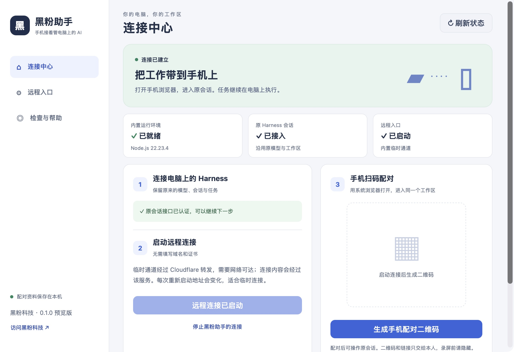
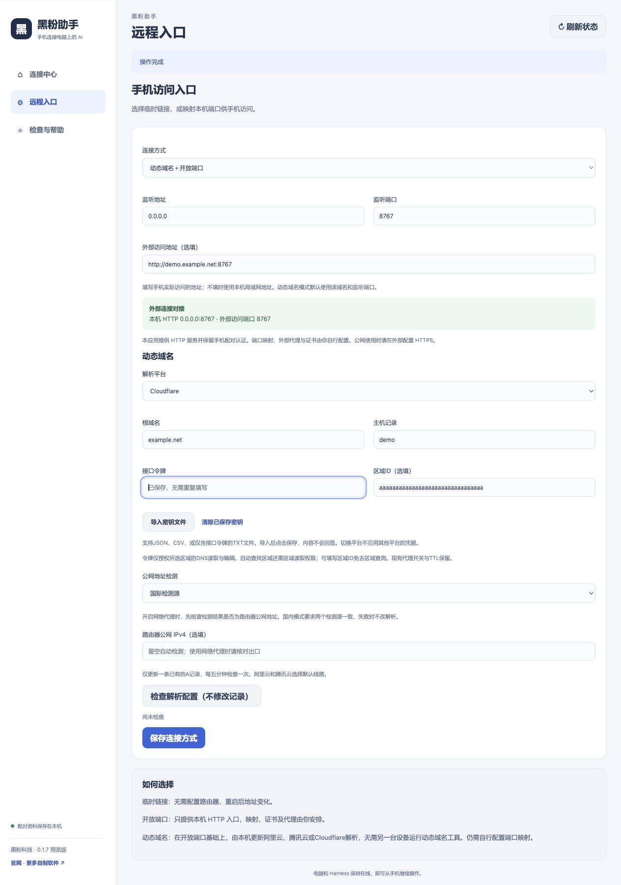
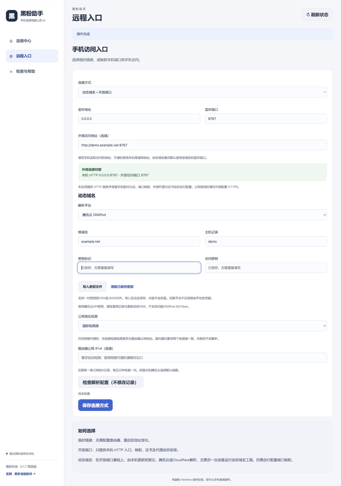
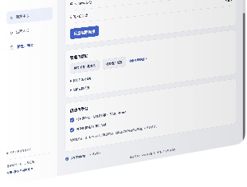

# 黑粉助手

**手机连接电脑上的 AI。** 电脑运行 DeepSeek Harness 原任务，手机浏览器进入同一工作区，查看会话并继续发送要求。

黑粉科技制作的独立辅助工具，Windows 与 Linux 当前正式安装版为 **1.0.1**，Mac 当前为 **1.0.0**。官方 Harness 是被连接的目标软件，需要先在电脑上安装、配置好模型并能正常使用。黑粉助手内置自己的运行依赖，无需另外安装 Node.js、通道程序或二维码组件。

Windows 与 Linux 可以从下方手动安装 1.0.1。Mac 1.0.1 安装包完成构建验收后补齐；在此之前，应用内自动更新仍指向三平台齐全的 1.0.0。完整图文步骤见[手机连接 DeepSeek Harness 教程](https://hyphentech.top/deepseek-harness-mobile-remote/)。

1.0.0 修复临时通道启动期间一次外网检查失败后，界面持续沿用旧状态的问题：等待阶段会自动复查，入口恢复后连接状态和二维码按钮自动更新。

1.0.1 修复开放端口与动态域名模式的二维码按钮：电脑无法回读自身外网地址时，仍能在本机生成二维码和一次性配对令牌，并提示用手机移动网络实际验证。二维码不依赖在线生成服务；临时链接仍需通道实际连通。

## 近期新增与改进

- 修复端口与动态域名模式被电脑外网回读误阻断的二维码按钮；二维码在本机生成。
- 修复临时通道等待阶段的旧状态沿用，并自动复查外网入口。
- 修复 Windows 启动检查卡住、非默认安装目录的 Harness 未被识别，以及已挂载配置在界面中跳回“重新选择”的问题。
- 临时通道启动后实际回读外网入口；若入口未连通，首页显示失败状态并暂不生成配对二维码。本机 Harness 接入状态单独显示。
- 平衡连接界面：左右卡片等宽，标题、主按钮和底部说明对齐，二维码展开后仍保持一致。
- 增加国内双源公网 IPv4 检测：与国际检测源分别选择，双源失败或不一致时停止更新，避免代理出口误写。
- 修复断开确认：取消、确认与退出键可用，更新弹窗文案独立。
- 三种连接方式：临时链接、开放端口、动态域名＋开放端口。动态解析可选阿里云、腾讯云DNSPod或Cloudflare。
- 证书在应用外配置：开放端口只提供 HTTP 服务，继续保留配对认证。
- 多平台动态域名：使用自己的平台凭据，每五分钟检查并更新已有A记录；支持相应密钥文件导入，不接管路由器和证书。
- 匿名使用统计：按日去重，支持在检查页的“提升使用体验”偏好中关闭，不采集会话和配对资料。
- 首页赞助入口：在连接状态区明确展示赞助提示与按钮，侧栏仅保留本机保存提示、版本及官网，避免重复展示赞助。

## 下载与安装

通过[发行页](https://github.com/HackerChi-Hub/hyphen-assistant-releases/releases)选择对应系统的安装包，并核对同名 `.sha256` 文件。没有附件的平台暂不提供下载，不使用源码压缩包代替安装包。

1.0.1 的 Windows/Linux 安装包来自源码提交 `1cca335b5bb10adbc50f2b8053b2d3511f69cbdf`。Windows 53 项测试通过，安装包解压后的内置后端和原生程序启动检查通过；Linux 52 项通过、1 项 Windows 专属测试跳过，AppImage 隔离启动通过。四份 SHA-256 与两份更新签名已核对，详情见[1.0.1 发行说明](https://github.com/HackerChi-Hub/hyphen-assistant-releases/releases/tag/v1.0.1)。Mac 仍使用已验收的 1.0.0；本轮未在真实 Harness 与手机网络上复测。

| 系统 | 安装方式 | 下载 |
|---|---|---|
| macOS Apple Silicon，13及以上 | 下载DMG，把黑粉助手拖入应用程序 | [Mac安装包](https://github.com/HackerChi-Hub/hyphen-assistant-releases/releases/download/v1.0.0/HyphenAssistant-1.0.0-macos-arm64.dmg) |
| Windows x64 | 下载EXE安装程序，按向导安装；包含离线WebView2安装器 | [Windows安装程序](https://github.com/HackerChi-Hub/hyphen-assistant-releases/releases/download/v1.0.1/HyphenAssistant-1.0.1-windows-x64-setup.exe) |
| Linux x64 | 使用AppImage或适合发行版的deb/rpm包，仍需兼容的桌面系统；AppImage首次需在文件属性中允许作为程序执行 | [AppImage](https://github.com/HackerChi-Hub/hyphen-assistant-releases/releases/download/v1.0.1/HyphenAssistant-1.0.1-linux-x64.AppImage) · [deb](https://github.com/HackerChi-Hub/hyphen-assistant-releases/releases/download/v1.0.1/HyphenAssistant-1.0.1-linux-x64.deb) · [rpm](https://github.com/HackerChi-Hub/hyphen-assistant-releases/releases/download/v1.0.1/HyphenAssistant-1.0.1-linux-x64.rpm) |

安装件尚未完成 Apple 公证或 Windows 商业代码签名。Mac首次打开受阻时，在系统设置的“隐私与安全性”中核实来源后选择仍要打开；Windows出现SmartScreen提示时核实发行来源，再按“更多信息”继续。更新包的数字签名用于校验更新完整性，不等同于操作系统发行证书。

## 实际界面

连接中心和隐私页为Mac安装界面；多平台表单为使用最终前端与安装版后端的隔离演示，使用虚构域名和测试凭据，未访问真实云账户。图片不含私人配对码。









## 三种连接方式

| 方式 | 应用完成 | 用户需要准备 |
|---|---|---|
| 临时链接 | 启动后生成临时地址，再扫码配对 | 网络能访问内置通道服务 |
| 开放端口 | 监听指定地址与端口，提供带配对认证的 HTTP 入口 | 自行安排端口映射、访问地址、外部代理与证书 |
| 动态域名＋开放端口 | 在开放端口基础上，每五分钟检查并更新所选平台已有的单条A记录 | 对应平台管理的域名、唯一A记录、最小权限凭据，以及自行配置的端口映射 |

开放端口默认监听 `0.0.0.0:8767`。将路由器公网 TCP 端口映射到电脑局域网地址与监听端口，手机使用实际外部地址。外部地址可填 HTTP 或 HTTPS；HTTPS 的反向代理与证书在应用外自行配置。未填写地址时，二维码使用本机局域网地址；该地址不代表公网已连通。

动态域名支持阿里云、腾讯云DNSPod和Cloudflare的IPv4 A记录。阿里云及腾讯云选择默认线路，Cloudflare要求主机名下只有一条A记录。先点“检查解析配置”只读检查，启动时才更新，之后每五分钟同步。不会创建新记录、修改其他主机或停止原有动态域名工具。密钥留空沿用已保存值，仅存于本机私有目录。检测请求固定使用 IPv4，适用于 A 记录。使用网络代理时可选择国内双源检测，先核对检测结果与路由器公网地址一致；国内模式必须两个来源均成功且一致才会更新。手动填写公网 IPv4 会固定使用该值，随公网地址变化自动更新应留空。自行停止其他设备对同一记录的重复更新后，可只用本机维护动态解析。

## 第一次使用

1. 先打开官方 DeepSeek Harness，确认电脑能正常收到模型回复。
2. 打开黑粉助手。已有手机连接器时选择“接入已有 Harness”；新用户选择当前 Harness 配置，点击挂载连接器。
3. 等待 Harness 加载连接器。若未自动加载，等原任务空闲后重新打开 Harness，不中断正在进行的任务。
4. 点击启动远程连接，等待入口就绪。
5. 生成二维码，用本人手机系统浏览器扫码并确认配对。
6. 进入一个不重要的会话，发送“只回复：手机连接正常，不调用工具”，核实实际回复。

## 网络与费用边界

内置临时通道由 Cloudflare 转发，网页内容经过该服务，需要网络可达，没有持续可用保证，重新创建后地址变化。开放端口与动态域名模式提供 HTTP 服务；公网使用应在外部配置 HTTPS。应用不配置路由器、防火墙、证书或证书续期。域名解析无法穿透运营商内网或替代端口映射。

工具不包含模型权重、供应商额度、域名或第三方付费服务。模型请求的费用与数据流向继续由原 Harness 配置决定。电脑、Harness、所用模型服务及网络须保持在线。

## 隐私与管理

二维码、链接和配对资料仅交给本人设备。配对后可操作原会话，手机浏览器应妥善保管。关闭窗口收起到菜单栏或托盘，退出界面保留后台；停止本应用连接不停止原任务。撤销登录会要求手机重新配对。

匿名统计仅包含不可逆设备哈希、应用版本、系统和架构，用于统计活跃设备与版本分布；默认开启，可在“检查与帮助”的“提升使用体验”偏好中关闭，具体采集范围可展开隐私说明查看。不采集会话、指令、文件、密钥、配对资料或用户名，统计数据库不保存 IP。设备哈希在本机按产品隔离后生成。同一设备同一 UTC 日去重，升级当天可更新版本。

源码仓库私有；本仓库发布使用说明、真实截图、安装件与更新元数据。安装件不包含开发者证书私钥、原会话、模型密钥或私人部署配置。

## 常见问题

**打开了但没有原会话？** 检查原 Harness 是否在线、配置是否选对、连接器是否加载，进入检查页查看原会话认证。

**临时连接失败？** 检查网络可达性，稍后重试或改用端口映射。不要关闭来源校验、证书校验或配对保护。

**配置选过又跳回选择框？** 更新到当前版本后，已挂载的配置会显示“连接器已挂载”。先打开 Harness，再刷新状态；另一份配置不能直接覆盖当前已管理的配置。

**电脑已接入，但外网入口未通过检查？** 临时通道依赖本机到 Cloudflare 的网络，需等通道实际连通后再生成二维码。开放端口和动态域名模式在 1.0.1 中可先生成二维码，用手机移动网络扫码验证；若手机打不开，再核对端口映射、域名、HTTPS 代理及防火墙。电脑访问自己的公网地址失败，也可能只是路由器不支持回流访问。

**配对失效？** 使用最新生成的完整链接，在十分钟内兑换；每个浏览器分别配对。网关重启后需要重新配对。

**手机切网和长任务是否都可靠？** 以当前发行说明列出的实际验收为准，一次页面打开不代表所有场景均已通过。

## 既有功能验收记录

- Mac：从DMG安装，双栏布局、内置后端、真实Harness认证及第三种模式配对通过；真实网页消息、空闲后回复、刷新后登录保持通过。临时通道与断开确认另有实际验收记录。
- Windows：原生41项检查、中文EXE安装、安装后内置后端及应用启动检查通过。
- Linux：原生41项检查、AppImage解包后的内置后端及虚拟桌面启动检查通过；同时提供deb和rpm。
- 阿里云动态域名：官方 SDK 签名对照与真实账户只读查询通过；更新、重复记录拒绝、不变不写与密钥保护通过隔离测试；现有环境完成真实更新与恢复、定时检查及消息收发验收。全新用户配置不依赖开发者域名、旧脚本、树莓派或证书文件。
- 三个平台的安装件都有SHA-256；更新包另有独立数字签名。Mac和Linux AppImage支持对应的签名更新包，deb/rpm使用新版安装包更新。
- 真实手机切网、真实任务工具批准和长任务恢复仍待专项验收；隔离启动检查不等同于真机持续使用。

## 相关资源

- [官方 DeepSeek Harness](https://github.com/deepseek-ai/deepseek-harness)
- [Cloudflare 临时通道说明](https://developers.cloudflare.com/tunnel/get-started/quick-tunnels/)
- [黑粉科技](https://hyphentech.top)

## 解析平台与密钥文件

在“动态域名＋开放端口”中选择解析平台。域名必须由所选解析平台管理；域名在哪里买不影响这一判断。本机只保存当前使用的平台配置，切换后需填写该平台的凭据，不会混用上一平台的密钥。

| 平台 | 凭据 | 导入格式 | 权限与范围 |
|---|---|---|---|
| 阿里云 | AccessKey ID、AccessKey Secret | CSV或JSON | 选定域名的查询记录及修改解析权限 |
| 腾讯云 DNSPod | SecretId、SecretKey | CSV或JSON | DescribeRecordList、ModifyDynamicDNS；使用腾讯云API密钥，不使用旧DNSPod ID/Token |
| Cloudflare | API Token；区域ID选填 | CSV、JSON或仅含令牌的TXT | 选定区域DNS读取与编辑；自动查询区域需区域读取权限，手填区域ID可免去区域查询 |

Cloudflare已有的代理开关、缓存时间及其他记录属性保持。若使用19527等自定义外网端口，需在Cloudflare控制台自行核对代理设置；标准代理支持的端口以[官方端口说明](https://developers.cloudflare.com/fundamentals/reference/network-ports/)为准。只用域名解析时，可自行设置为仅DNS。应用不会自动切换代理或修改证书。

连接运行时，点击“停止连接并修改配置”后可编辑。更换成对密钥须同时填写两项；留空保留当前平台已存值。点击“清除已保存密钥”只清除本机凭据及旧检查状态，保留域名、监听参数、云端解析和外部证书。清除后需重新填写或导入并保存，才能启动动态域名连接。

导入文件最多64KB，一次仅允许一组凭据。导入只填入当前表单，内容隐藏，点击保存后才写入本机。格式错误、多个账户、重复字段或跨平台凭据会被拒绝，不覆盖已有输入。原文件不上传、不复制到应用目录，请自行妥善保存。证书文件、Cloudflare Global API Key和旧DNSPod令牌不属于此导入格式；暂不支持STS临时凭据。

CSV表头分别使用 `AccessKey ID,AccessKey Secret`、`SecretId,SecretKey` 或 `APIToken,ZoneId`。Cloudflare的ZoneId列可留空。JSON示例中的值均须换成自己的真实凭据：

```json
{"provider":"aliyun","AccessKeyId":"自己的密钥标识","AccessKeySecret":"自己的访问密钥"}
```

```json
{"provider":"tencent","SecretId":"自己的密钥标识","SecretKey":"自己的访问密钥"}
```

```json
{"provider":"cloudflare","apiToken":"自己的接口令牌"}
```

Cloudflare的TXT文件只放令牌，不加引号或其他文字。阿里云旧配置会自动按阿里云识别，升级不要求重新填写原密钥。

## 本版多平台验收

- 每个平台操作系统通过41项检查，安装后内置后端及原生程序启动通过。
- 腾讯云签名与官方SDK 4.1.220四组向量一致，覆盖中文载荷、分页、UTC日期边界；阿里云签名再次对照官方SDK通过。
- 用最终Mac安装版的内置Node和后端，在三个全新用户目录验证：自有域名与端口配置、模拟查询和更新、只读检查、不变不写、错误保存保护、清除凭据与快照不泄密。
- 使用最终前端和安装版后端的隔离界面，验证腾讯云CSV、Cloudflare JSON导入保存、跨平台误导入拒绝、切换后不沿用密钥与确认清除。
- 新增腾讯云和Cloudflare按用户要求使用模拟接口验收，没有执行真实云账户的DNS写入。真实账户的权限、套餐、网络与解析生效仍须由使用者通过“检查解析配置”和实际手机访问核实。不能把模拟成功理解为对所有账户环境的保证。

接口对照：[腾讯云查询记录](https://cloud.tencent.com/document/api/1427/56166)、[腾讯云动态更新](https://cloud.tencent.com/document/api/1427/56158)、[Cloudflare更新记录](https://developers.cloudflare.com/api/resources/dns/subresources/records/methods/edit/)。
