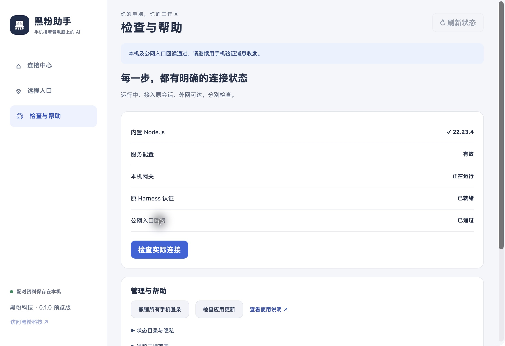

# 黑粉助手

**手机接着管电脑上的 AI。** 电脑运行 DeepSeek Harness 原任务，手机浏览器进入同一工作区，查看会话并继续发送要求。

黑粉科技制作的独立辅助工具，当前为 **0.1.0 预览版**。官方 Harness 是被连接的目标软件，需要先在电脑上安装、配置好模型并能正常使用。黑粉助手内置自己的运行依赖，无需另外安装 Node.js、通道程序或二维码组件。

## 近期新增与改进

- 中文桌面连接中心：连接原会话、查看网关状态与实际公网回读。
- 内置运行依赖：安装包携带 Node.js、配对网关和远程通道组件。
- 临时远程入口：无需填写域名和证书；也支持已有代理与固定 HTTPS。
- 手机二维码配对：十分钟、一次兑换；可复制私人链接及撤销全部手机登录。
- 后台与更新管理：菜单栏或托盘、登录启动偏好、带数字签名校验的更新入口。

## 下载与安装

通过[发行页](https://github.com/HackerChi-Hub/hyphen-assistant-releases/releases)选择对应系统的安装包，并核对同名 `.sha256` 文件。没有附件的平台暂不提供下载，不使用源码压缩包代替安装包。

| 系统 | 安装方式 |
|---|---|
| macOS Apple Silicon，13及以上 | 下载DMG，把黑粉助手拖入应用程序 |
| Windows x64 | 下载EXE安装程序，按向导安装；包含离线WebView2安装器 |
| Linux x64 | 使用AppImage或适合发行版的deb/rpm包，仍需兼容的桌面系统 |

安装件尚未完成 Apple 公证或 Windows 商业代码签名，首次启动按系统提示核实来源。更新包的数字签名用于校验更新完整性，不等同于操作系统发行证书。

## 实际界面

以下为0.1.0预览版Mac实际安装界面，未展示私人配对码。

## 第一次使用

1. 先打开官方 DeepSeek Harness，确认电脑能正常收到模型回复。
2. 打开黑粉助手。已有手机连接器时选择连接已有配置；新用户选择当前 Harness 配置，点击挂载连接器。
3. 等待 Harness 加载连接器。若未自动加载，等原任务空闲后重新打开 Harness，不中断正在进行的任务。
4. 点击启动远程连接，等待入口就绪。
5. 生成二维码，用本人手机系统浏览器扫码并确认配对。
6. 进入一个不重要的会话，发送“只回复：手机连接正常，不调用工具”，核实实际回复。

## 网络与费用边界

内置临时通道由 Cloudflare 转发，网页内容经过该服务，需要网络可达，没有持续可用保证，重新创建后地址变化。第三方通道不支持的传输方式可能影响特定功能，真实消息和长任务恢复须实际核实。长期使用可改为自己的固定域名、证书、HTTPS代理或私有通道。应用不自动修改路由器与防火墙。

工具不包含模型权重、供应商额度、域名或第三方付费服务。模型请求的费用与数据流向继续由原 Harness 配置决定。电脑、Harness、所用模型服务及网络须保持在线。

## 隐私与管理

二维码、链接和配对资料仅交给本人设备。配对后可操作原会话，手机浏览器应妥善保管。关闭窗口收起到菜单栏或托盘，退出界面保留后台；停止本应用连接不停止原任务。撤销登录会要求手机重新配对。

源码仓库私有；本仓库发布使用说明、真实截图、安装件与更新元数据。安装件不包含开发者证书私钥、原会话、模型密钥或私人部署配置。

## 常见问题

**打开了但没有原会话？** 检查原 Harness 是否在线、配置是否选对、连接器是否加载，进入检查页查看原会话认证。

**临时连接失败？** 检查网络可达性，稍后重试或改用固定入口。不要关闭来源校验、证书校验或配对保护。

**配对失效？** 使用最新生成的完整链接，在十分钟内兑换；每个浏览器分别配对。网关重启后需要重新配对。

**手机切网和长任务是否都可靠？** 以当前发行说明列出的实际验收为准，一次页面打开不代表所有场景均已通过。

## 相关资源

- [官方 DeepSeek Harness](https://github.com/deepseek-ai/deepseek-harness)
- [Cloudflare 临时通道说明](https://developers.cloudflare.com/tunnel/get-started/quick-tunnels/)
- [黑粉科技](https://hyphentech.top)
